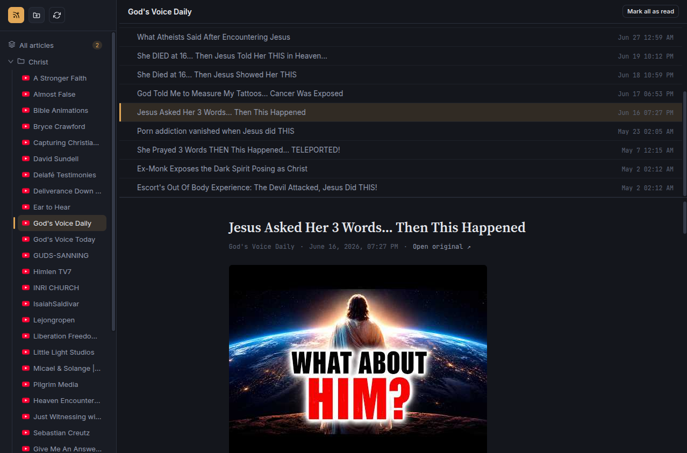

# Private RSS Reader

A self-hosted, single-file RSS/Atom reader. No database, no build step, no dependencies — just one `index.php` you drop on any PHP server.



## Features

- **Single-file app** — backend, API, and frontend (HTML/CSS/JS) all live in `index.php`. Deploy by copying one file.
- **Folders** — organize feeds into folders, with drag-and-drop reordering and moving.
- **Unread tracking** — per-feed and per-folder unread counts, mark single articles or entire folders as read.
- **Auto-discovery** — add a site URL and the reader will detect its RSS/Atom feed automatically.
- **Smart refresh** — feeds are cached and only re-fetched when stale (5 min TTL), with a shared throttle so multiple open tabs/clients don't hammer the source site with requests.
- **Background auto-refresh** — the UI polls for new articles every 5 minutes.
- **Resizable, responsive UI** — draggable sidebar and article-list panes, with a mobile-friendly collapsible drawer.
- **JSON storage** — feeds and settings are stored as flat JSON files under `./data/`, no database required.

## Requirements

- PHP 7.4 or newer
- `ext-dom` and `ext-json` (required)
- `ext-curl` (optional — falls back to `file_get_contents` if unavailable)

## Installation

1. Copy `index.php` to a directory served by PHP (e.g. via Apache, Nginx + PHP-FPM, or `php -S`).
2. Make sure the web server user can create and write to a `data/` directory next to `index.php` (it will be created automatically on first run).
3. Open the page in your browser and start adding feeds.

```bash
# Quick local test
php -S localhost:8000
```

Then visit `http://localhost:8000`.

## Usage

- **Add a feed** — click "Add feed" and paste either a direct feed URL or a website URL (auto-discovery will find the feed for you).
- **Organize** — create folders and drag feeds into them.
- **Read** — select "All articles", a folder, or a single feed to view its items. Mark items as read individually or in bulk.
- **Refresh** — trigger a manual refresh of all feeds, or let the background auto-refresh handle it.

## Data storage

All data is stored as JSON under `data/`:

- `data/feeds.json` — feed and folder definitions
- `data/cache/*.json` — cached articles per feed

No database setup is required. Back up the `data/` directory to preserve your feeds and read state.

## Security notes

This app has no built-in authentication. If exposing it beyond `localhost`, put it behind your own auth layer (e.g. HTTP basic auth, a reverse proxy with access control, or a VPN).

## License

Add a license of your choice (e.g. MIT) here.
